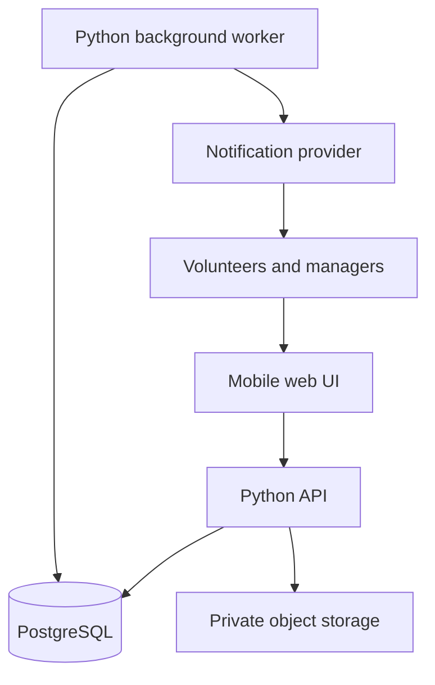

# Proposed architecture and system design

Status: proposal, 2026-10-05. Python and a real database are requirements; the named tools below are candidates. No hosting provider has been selected.

## Context and scale

One station, about 240 users, mobile browsers, Hebrew RTL. Bursts around registration deadlines and schedule publication. Peak concurrency and response-time objectives are not measured; 50 simultaneous demo users is a provisional test scenario, not a discovered requirement. Design for correctness and maintainability before distributed infrastructure.

## Components

- UI candidate: React + TypeScript. Mobile-first components, RTL and Hebrew validation messages. PWA installation and push behavior need validation before promising native-like delivery.
- API candidate: FastAPI, with modules for accounts/access, registration, schedules, mentoring, notifications and audit.
- Persistence candidate: PostgreSQL, SQLAlchemy and Alembic migrations.
- Worker: separate process from the same Python codebase. Handles timed events and notification delivery. A database outbox avoids needing a broker for the initial scale.
- Object storage: private files with server-authorized access; photos and uploads can follow the core prototype.
- Production hosting, authentication provider and notification channel are open decisions.

## Authentication and authorization

Authentication identifies the account; authorization checks role, station, home day, current assignment, schedule state and time window. Use one policy layer shared by API routes. Do not trust user-supplied role or membership claims. A day manager's authority is scoped to managed days.

A same-origin deployment with secure HttpOnly session cookies is a candidate. Include CSRF protection, login rate limiting, session expiry and a recovery flow if chosen. Passwords must be hashed using a maintained password-hashing library. Unique email can identify an account; full-name login remains unresolved. Do not implement ambiguous full-name authentication without addressing collisions.

Evaluate permission expiry on each request, using server time; access must not depend on a cleanup worker having run. List endpoints, counts and file URLs need the same protection as detail endpoints. Mentors may read prior history during their window, but editing historical records is not automatically allowed. Private-summary revocation removes future application access.

## Main flows and transaction boundaries

### Registration

Store one response per user per activity date. Registration is evening availability; the manager may assign morning or reinforcement without independent signup. Late edits notify the manager and do not automatically alter a published assignment. Precise handling of withdrawing after publication remains open.

### Publish schedule

Within one transaction: verify authority, validate structural consistency, mark the activity-day schedule published, record actor/time, and insert notification outbox records. Delivery occurs after commit. A retry must not duplicate publication notifications. Planned publication time alone cannot publish.

### Cancel ambulance

Within one transaction: cancel the slot, end its active assignments, return users to the relevant waiting state, revoke guest eligibility and record the change/outbox event. Preserve history. Decide whether published guests receive the change notification even though their schedule access has ended; never expose inaccessible schedule content in that message.

### Save ride

Check trainee/mentor permissions and field-level rights. Save the ride once, serialize per-trainee sequence allocation, update the progress projection and record editors. Use a version check on shared records; return a conflict instead of overwriting another author's work. Counts must follow canonical ride records plus explicit manager corrections, never browser counters.

## Worker behavior

Persist due work and outbox entries. Claim jobs safely so overlapping worker runs do not duplicate effects. Use retry limits, backoff and recorded failures. An API request must also derive whether registration is open from configured timestamps, even if the worker is delayed. Registration changes can be allowed after closure under the agreed late-edit rule.

Notification states: queued, accepted by provider, failed; delivered only if verified by the provider. Deduplicate logical events per recipient. Do not put mentoring text in push payloads.

## Reliability and operations

- Store timestamps in UTC; calculate local windows using Asia/Jerusalem, including DST. Use local dates explicitly for the activity calendar.
- Separate demo/development and later production data.
- Backups and an actual restore exercise before a real-data pilot. Recovery time and acceptable data loss need agreement.
- Structured logs with request IDs, health checks and alerts for worker failure; avoid personal/clinical text and credentials in logs.
- Optimistic concurrency for journals and schedule edits; database locking for capacity and unique sequence allocation.
- Proposed performance target: typical actions within 2 seconds on a reasonable connection, with server latency measured separately. Confirm conditions before making this an acceptance commitment.
- Online-first proposed prototype. Offline drafting and full offline operation are separate decisions; retain typed text through transient save failures where feasible.

## Intentionally deferred infrastructure

No microservices, Redis, Kubernetes, event streaming or live collaborative editing unless measured requirements justify them. Polling/refetch and explicit conflicts can support the initial usage. Holiday-provider integration, push and photos get explicit interfaces rather than hidden mock success.
