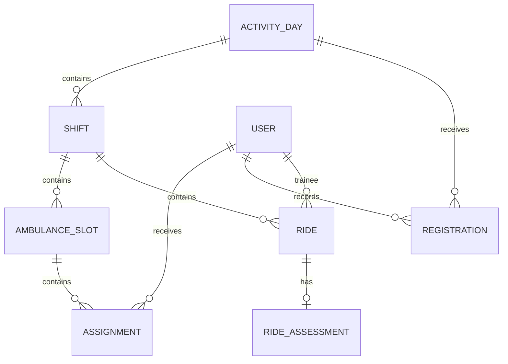

# Proposed relational data model

Status: design proposal. Confirm relevant open questions before migrations. UUID internal identifiers, UTC instants, local activity dates and explicit foreign keys are recommended.

## Entities

| Entity | Key fields and purpose |
| --- | --- |
| stations | Station identity; seed only Rishon LeZion. |
| users | Unique normalized email, full name, phone, active status, optional photo; authentication identity. |
| user_roles | User and role; supports overlapping roles. |
| day_memberships | User, weekday, valid_from, valid_to; home-day transfer history. |
| manager_day_scopes | Manager, weekday, validity; separate management authority. |
| registration_templates | Weekday and configurable local opening/closing rules; versioned defaults. |
| activity_days | Station, local date, classification, registration timestamps, publication state/actor/time, version. |
| shifts | Activity day, type, start/end/arrival timestamps. |
| ambulance_slots | Shift, available volunteer capacity, active/cancelled status, version; not a fleet vehicle. |
| registrations | User, activity day, yes/no, optional arrival time, updated_at. |
| invitations | Named user, activity day/shift, inviter, status and expiry; conditional UI. |
| assignments | User, ambulance slot, active/ended state, timestamps and actor. |
| rides | Trainee, shift, local occurrence date, trainee sequence, description, version, creator. |
| ride_assessments | Ride, performance markers, summary, improvement/preservation notes; versioned. |
| ride_contributors | Ride and author; preserve multiple mentor contributors. |
| progress_corrections | Trainee, manager, reason, correction values and time; immutable correction history. |
| mentor_access_extensions | Mentor, trainee, shift, grantor, start/end and revocation. |
| personal_summaries | Trainee, optional shift, content, shared flag and version. |
| notification_outbox | Logical event, recipient, payload reference, deduplication key, attempts/status. |
| audit_events | Actor, action, object ID, timestamp and appropriately minimized change metadata. |

No completion/submission state is assumed for mentoring. A definition of incomplete content is needed before reminder logic. Separating rides and assessments is a proposal for field-level permissions, not a new product requirement.

## Relationships

## Integrity and concurrency rules

- One activity day per station/date; one registration per user/activity day; one active home-day membership per user.
- Unique trainee/ride sequence and logical notification deduplication key.
- Prevent duplicate active assignments within the relevant shift/date. Whether a trainee can move from reinforcement to evening on the same date must be resolved before imposing a blanket date-level uniqueness rule.
- Slot capacity must be checked in a transaction with a lock or equivalent atomic constraint; a UI check is insufficient. Entering raw available capacity is a proposed default pending confirmation.
- The system must not forbid role combinations (for example a trainee without a mentor). Capacity is a structural limit, not a crew recommendation.
- Preserve cancelled assignments and historical role/membership state; do not cascade-delete mentoring history on transfer or deactivation.
- Allocate ride sequence atomically per trainee. Define how deletion, correction and imported historical counts affect display sequence before implementing them.
- Ride count and last ride date derive from canonical rides, with a documented overlay for manager corrections. Do not silently fabricate rides to represent legacy totals.
- Define last ride date from actual ride occurrence, not signup or assignment. A shift with no ride does not advance it.
- Use version columns on shared editable records; stale writes return conflicts.

## Access derived from relationships

Home-day members can read published schedules for their day. Assigned guests can read only during the publication-to-shift-end interval. Invitation alone does not expose a draft or grant journal access.

Formal mentors assigned to a crew can access trainees in that crew during the configured window; all crew mentors count, without a permanent mentor-trainee ownership relation. Historical crew membership and extensions need preservation so later edits do not rewrite authorship. Exact post-cancellation mentoring access is open.

The current home-day manager has journal access; the previous manager loses it on transfer. Guest-day managers receive progress summary only. Youth oversight receives progress summary only, without mentoring content. A trainee's private summary must be excluded from unauthorized queries, counts and search results.

## Fields still unresolved

Exact marker semantics (✓ / ✗ / חסר / ויקס), journal field ownership, manager edit limits, progress correction semantics, data retention, contact/photo visibility, invitation response states, Saturday access rules and journal completion conditions. Avoid irreversible schema assumptions around these.
