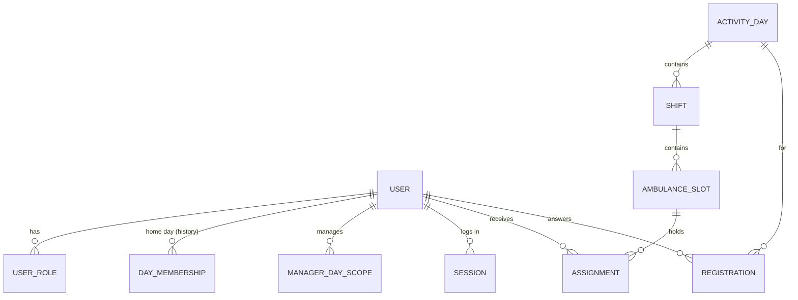

# Design review — Phase 0

Status: proposal for review, 2026-10-05. Nothing here is approved until Adi confirms it. Items marked **[assumption]** are reversible demo defaults, recorded so they can be changed later without a rewrite.

Inputs: CLAUDE.md, PRODUCT_REQUIREMENTS.md, ARCHITECTURE.md, DATA_MODEL.md, OPEN_QUESTIONS.md, DEVELOPMENT_PLAN.md.

---

## 1. Confirmed requirements vs. proposals

### Confirmed (user decisions — treat as requirements)

| Area | Requirement |
|---|---|
| Platform | Hebrew-only, RTL, mobile-first. Python backend, real persistent DB, synthetic data only. |
| Accounts | One account per person, stable internal ID, unique email. Multiple roles per person (e.g. manager + mentor). Role change ≠ new account. Self-signup; manager assigns day and role. Inactive keeps history. One home day per volunteer, mentors included. Trainee→youth is a manual manager action with a recorded date. Password login first. |
| Home-day transfer | New manager gets the mentoring history; previous manager loses access. |
| Scope | Sun–Fri + Saturday in v1. Six day managers + Saturday manager + youth oversight. Drivers are not users. MICU, community security, courses, attendance, crew recommendations, internal announcement board: out. |
| Registration | Evening availability per date, yes/no + optional "arriving at…" time. No early-leave field. Automatic open/close per day schedule (manager can change it). Volunteer can edit; after close, a change notifies the manager. Manager can add a non-registrant. Other days only via personal invitation; invitation UI only when an active invitation exists. |
| Scheduling | Manual only, no priority formula/recommendations. Hidden draft, whole schedule published at once, always manual approval (target time never publishes). Trainee card shows ride count + last ride date. No role-based crew blocking. Unassigned registrants stay waiting. Ambulance cancellation returns crew to waiting. Ambulances can be added after publication. No post-publication confirmation, no attendance. Reinforcement: trainees only, pre-assigned from evening registrants. |
| Access | Home-day members: permanent access to published schedules. Assigned guests: from publication until shift end; cancellation revokes immediately. Mentors: crew trainees only, 1h before shift → next day 10:00, history readable. Guest-day manager and youth oversight: ride count + last ride date only. Private summary: trainee only, existence hidden. Shared summary: trainee + home-day manager, revocable. Enforced server-side. |
| Journal | Cumulative per trainee; one record per ride linked to a shift; sequential ride number. All crew mentors mentor all crew trainees. Youth never assess. Trainee may record rides when no formal mentor. Save = visible to trainee and manager (no submission). Concurrent mentor edits must not overwrite. Count/last date derived from rides; shift with no ride doesn't move the date. Manual correction: manager only. No counts for youth/mentors. Manager can reopen mentor access. Fictional cases only. |
| Notifications | Push-style to iPhone and Android for: registration open, closing soon, published, assigned, change, new ambulance, documentation reminder. Changes go to the whole shift. Late registration change → manager. Track created / handed to provider / failed; never claim "delivered" without proof. |

### Proposals (not approved — need a yes/no)

FastAPI, PostgreSQL, SQLAlchemy/Alembic, React+TS, cookie sessions, outbox + worker, object storage, the DATA_MODEL table split (rides vs. assessments), manual escalation for new-ambulance notifications, "summaries after core flows" prioritisation, 2-second performance target, online-first.

---

## 2. Contradictions and ambiguities

Ordered by how soon they block work. **Blocks** = which slice needs the answer.

| # | Issue | Where | Why it matters | Proposed default | Blocks |
|---|---|---|---|---|---|
| C1 | **"Saturday is open to all days"** vs. **"other days only via personal invitation; no open cross-day signup."** | Hebrew §1 vs. clarifications + §4 | Saturday is either an exception to the invitation rule or it isn't. Also: who sees the published Saturday schedule — only those assigned (guest rule) or everyone? | Saturday is a *managed day with no home-day members*. Every active volunteer may register; everyone is treated as a guest for schedule access. **[assumption]** | Slice 2 |
| C2 | **"Registration closes automatically"** vs. **"volunteer can still edit after close (manager is notified)."** | §4 | If edits continue, what does "closed" actually stop? Can someone who never answered register "yes" after close? | Close does not lock. After close, any change (including a first answer) is marked *late* and creates a manager notification. **[assumption]** | Slice 1 |
| C3 | **"Never show drafts"** vs. **"manager makes changes after publication / adds ambulances."** | §5, CLAUDE.md | After publish, is each edit immediately public (live schedule), or does the manager edit a hidden draft and re-publish a batch? | v1: live schedule after publication; each post-publish edit is an explicit action with a confirm dialog and triggers a change notification. Batch re-publish is a later option. **[assumption]** | Slice 2 |
| C4 | **Registration is evening-only** vs. **Fri/Sat/holidays have a morning shift and "no self-registration for morning."** | §3, §4 | On Saturday, who populates the morning shift? From evening registrants? | Same rule everywhere: manager assigns morning from that date's registrants or adds people manually. Needs confirmation for weekends. | Slice 2 |
| C5 | **Who can reopen mentor access** for a *guest* trainee? The trainee's home-day manager has the journal; the shift's manager only sees counts. | §6, §7 | Two managers, neither clearly owns the action. | The trainee's current home-day manager. | Slice 3 |
| C6 | **Guest mentor:** schedule access ends at shift end, but the journal window runs to next day 10:00. | §6 | Two different resources, two different windows — easy to implement accidentally as one. | Keep them separate (journal window applies to guest mentors too). Confirm. | Slice 3 |
| C7 | **"Formal mentor"** — is it the user's role, or their position in this crew? A manager+mentor riding in a crew: mentor? | §2, §5 | Determines who gets journal access. | Formal mentor = holds an active *mentor* role on the shift date. No per-assignment "position" field. | Slice 3 |
| C8 | **Private summary existence must be hidden** vs. **ARCHITECTURE's "audit events for every change."** | §6, ARCHITECTURE | An audit log a manager can browse would leak that a private summary exists. | Private-summary writes are never exposed via manager-visible audit/activity feeds; no reminders or counts mention them. | Slice 5 (design now) |
| C9 | **Notification provider:** SNS was mentioned, but the UI is a mobile web app. | §1, §8 | SNS mobile push is built around native-app tokens (APNs/FCM). A PWA normally uses standard Web Push (VAPID), and on iPhone only works once installed to the home screen. | Decide after a device spike; don't commit to SNS yet. | Slice 4 |
| C10 | **Manager adds a non-registrant** — may that be someone from another day without an invitation? | §4, §5 | Bypass of the invitation rule. | Yes for the day manager (manager action is explicit + audited); confirm. | Slice 2 |

Already captured in OPEN_QUESTIONS.md and not repeated here: mentor-window anchor (arrival vs. start), reinforcement→evening on the same date, invitation semantics, change-notification audience, marker meanings, "incomplete" definition, correction semantics.

---

## 3. Stack and architecture tradeoffs

Shape: **modular monolith** (one Python codebase, one DB, an API process and a worker process). Same as ARCHITECTURE.md. At 240 users, microservices would add network failure modes and deployment cost with nothing to show for it.

| Decision | Recommendation | Alternative | Tradeoff in one line |
|---|---|---|---|
| Web framework | **FastAPI** | Django | Django ships admin, sessions, CSRF and auth for free — a strong fit for a permissions-heavy CRUD app. FastAPI means building those yourself, but it's what ML serving uses and is on your learning list. Pick FastAPI for career alignment, accepting ~1–2 days of extra auth plumbing. |
| DB access | **SQLAlchemy 2.0, sync** | async SQLAlchemy | Async gains nothing at this load and makes transactions/locking tests harder. Sync with a threadpool is simpler and fully correct. |
| Database | **PostgreSQL** | SQLite | You need row locks (`FOR UPDATE`), partial unique indexes, exclusion constraints and `timestamptz`. SQLite can't test the concurrency rules honestly. |
| Migrations | **Alembic** | — | Standard; every schema change is a reviewed file. |
| Frontend | **React + TypeScript (Vite)**, thin | Server-rendered Jinja + HTMX | HTMX = one language and less code. React = better portfolio signal and a cleaner path to PWA push. Keep all rules in the backend either way. |
| Sessions | **Server-side sessions table + HttpOnly cookie** | JWT | Revocation must be immediate (guest cancelled, role removed). With a DB session and per-request permission lookup that's automatic; with JWTs you'd need a blocklist anyway. |
| Background work | **Postgres outbox + worker** (`SELECT … FOR UPDATE SKIP LOCKED`) | Celery + Redis | No broker to run; jobs and the data change commit atomically. Revisit only if load demands it. |
| Progress (ride count, last date) | **Derived by query** from rides + corrections | Stored projection table | A query over a few hundred rows per trainee is instant and can't drift. Add a projection only if measured slow. |
| "Waiting" list | **Derived**: registered *yes* and no active assignment that day | Stored waiting table | Cancelling an ambulance "returns people to waiting" automatically, with no state to keep in sync. |

---

## 4. Authorization approach

### Principles

1. **Load the actor from the DB on every request** (user, active roles, home-day membership, manager scopes). Nothing about permissions is trusted from the client or the cookie.
2. **Grants are derived from relationships + time**, not stored as permission rows. "Can Dana read Thursday 15/10?" = she's a Thursday member, *or* she has an active assignment and the schedule is published and `now < shift.ends_at`, *or* she manages Thursdays. Cancellation and expiry therefore take effect on the next request, without a cleanup job.
3. **One `access` module owns every rule.** Two kinds of function:
   - `authorize(actor, action, obj, now)` → allow/deny for single-object actions (publish, assign, edit ride).
   - `visible_<thing>(actor, now)` → a SQLAlchemy filter used by *every* list, count and detail query. This is what stops list endpoints, counts and search from leaking what the detail endpoint hides.
4. **404 vs 403:** if the actor can't even know the object exists (draft schedule, private summary, a trainee outside their window) → **404**. If they can see it but not perform the action → **403**.
5. **`now` is injected** (a `Clock` dependency), so time-window rules are testable at exact boundaries.
6. **Server time, `timestamptz` in UTC**, local rules computed in `Asia/Jerusalem` via `zoneinfo`. "Next day 10:00" is built as a *local* datetime and then converted. It must never be "shift end + N hours":

   | Shift ends (local) | Window end (local) | Correct UTC | Naive "+11h" |
   |---|---|---|---|
   | Thu 15/10/2026 23:00 | Fri 16/10 10:00 | 07:00 | 07:00 ✓ |
   | Sat 24/10/2026 23:00 | Sun 25/10 10:00 (DST ended 02:00) | **08:00** | 07:00 ✗ |

   That second row is a required test case.

### Why not a policy library (Casbin, Oso, OpenFGA)?

The rules are relational *and* temporal ("assigned in the same ambulance, until 10:00 the next day"). A DSL would still need these joins written by hand, plus a second language to learn. Plain Python + SQL predicates, backed by an exhaustive test matrix, is easier to audit. (For interviews: OpenFGA/Zanzibar is the "at scale" answer to the same relationship-based model.)

Postgres row-level security as defence-in-depth: worth knowing about, but deferred. It complicates connection/session handling for a small team.

### Access matrix (target; ✓ = allowed, — = 404)

| Resource ↓ / Actor → | Home-day volunteer | Assigned guest | Crew mentor | Trainee (self) | Home-day manager | Guest-day manager | Youth oversight | Unassigned new user |
|---|---|---|---|---|---|---|---|---|
| Draft schedule | — | — | — | — | ✓ edit | — | open question | — |
| Published schedule (own day) | ✓ always | — | — | ✓ | ✓ | — | ? | — |
| Published schedule (other day) | — | ✓ publish→shift end | — | — | — | ✓ (their day) | ? | — |
| Waiting list + registrations | own only | own only | own only | own only | ✓ | ✓ (their day) | ? | — |
| Trainee ride count + last date | — | — | ✓ in window | ✓ | ✓ | ✓ | ✓ | — |
| Journal content | — | — | ✓ in window (crew trainees) | ✓ | ✓ | — | — | — |
| Private summary | — | — | — | ✓ | — (no hint) | — | — | — |
| Shared summary | — | — | — | ✓ | ✓ until unshared | — | — | — |
| Own profile | ✓ | ✓ | ✓ | ✓ | ✓ | ✓ | ✓ | ✓ |

### Policy test design

A table-driven `pytest` matrix: **persona × resource × time point → expected status**. It covers slot boundaries (1 second before and after shift end, 10:00 next day, the DST row above, publication instant), plus the transitions "assignment cancelled", "home day transferred" and "summary unshared". Example rows:

```text
guest_dana | schedule(thu-15-10) | 15/10 22:59:59 | 200
guest_dana | schedule(thu-15-10) | 15/10 23:00:00 | 404
guest_dana | schedule(thu-15-10) | after cancel   | 404
thu_member | schedule(thu-15-10) | while draft    | 404
thu_member | schedule(thu-15-10) | 2027-01-01     | 200
```

---

## 5. Data model

Builds on DATA_MODEL.md. Changes and additions are **bold**.

### Conventions

UUID PKs. `timestamptz` for instants, `date` for activity dates, `time` for a chosen arrival time. `citext` for email. Enums as Postgres enums or check constraints. Soft states (`status`, `ended_at`) instead of deletes for anything with history. `version int` on records that can be edited concurrently.

### Identity and roles

```text
users(id, email citext UNIQUE, full_name, phone, status[pending|active|inactive],
      password_hash, created_at)
sessions(id, user_id, created_at, expires_at, revoked_at)                 -- NEW
user_roles(id, user_id, role, valid_from, valid_to NULL, granted_by)      -- history = transition date
day_memberships(id, user_id, weekday[0..5 Sun–Fri], valid_from, valid_to NULL)
   EXCLUDE no overlapping validity per user  -- "one home day at a time"
manager_day_scopes(id, user_id, weekday[0..6], valid_from, valid_to NULL)
```

**Role-model proposal (needs a yes):** split roles into
- a **volunteer level** — exactly one of `trainee | youth | mentor` at a time, with history (gives the trainee→youth date for free), and
- **authority roles** — `day_manager` (via scopes), `youth_oversight`, `admin` (bootstrap only), which stack on top.

This still supports "multiple roles" (manager + mentor), but makes "trainee and mentor at once" impossible. If that combination can happen in real life, drop the constraint and keep a flat `user_roles` table.

### Calendar and schedule

```text
registration_templates(id, weekday, opens_rule, closes_rule, publish_target_rule, valid_from)
activity_days(id, station_id, local_date, day_kind[regular|friday|saturday|holiday|holiday_eve],
              registration_opens_at, registration_closes_at, publish_target_at,  -- copied from template, editable
              schedule_status[draft|published], published_at, published_by, version)
   UNIQUE(station_id, local_date)
shifts(id, activity_day_id, kind[morning|reinforcement|evening],
       arrival_at, starts_at, ends_at)                     -- both arrival and start stored (mentor-window question)
   UNIQUE(activity_day_id, kind)
ambulance_slots(id, shift_id, ordinal, capacity smallint CHECK 1..6,
                status[active|cancelled], cancelled_at, cancelled_by, version)
registrations(id, user_id, activity_day_id, available bool, arrival_time time NULL,
              source[self|manager|invitation], is_late bool, updated_at, updated_by)
   UNIQUE(user_id, activity_day_id)
assignments(id, user_id, slot_id, shift_id, activity_day_id,     -- shift/day denormalised for constraints
            status[active|ended], ended_reason[removed|slot_cancelled|moved],
            created_at, created_by, ended_at, ended_by)
   UNIQUE(user_id, shift_id) WHERE status='active'              -- no double-booking in one shift
invitations(id, user_id, activity_day_id, invited_by, status, expires_at)   -- semantics open
```

Not imposed yet: one active assignment per *date* (pending the reinforcement→evening question).

### Journal (slice 3; from DATA_MODEL with two changes)

```text
rides(id UUID ← generated by the client, trainee_id, shift_id, occurred_on date,
      seq int, description, created_by, version)
   UNIQUE(trainee_id, seq)
ride_assessments(ride_id PK, markers jsonb, summary, improve, preserve, version)
ride_contributors(ride_id, user_id, first_edit_at)
progress_corrections(id, trainee_id, manager_id, reason, delta_count|override_*, created_at)  -- semantics open
mentor_access_extensions(id, mentor_id, trainee_id, shift_id, granted_by, starts_at, ends_at, revoked_at)
personal_summaries(id, trainee_id, shift_id NULL, content, shared bool, version)
```

- **Client-generated ride ID** makes "save" idempotent: a retry after a dropped connection hits `ON CONFLICT DO NOTHING` rather than creating ride #13 twice.
- **`seq` allocation:** inside the insert transaction, lock the trainee's row (`SELECT … FOR UPDATE` on `users`) and use `max(seq)+1`. The unique constraint is the safety net.
- **Markers as `jsonb`** until their meanings are settled. This avoids an irreversible column design (per DATA_MODEL's warning).

### Ops tables

`notification_outbox`, `audit_events` — as in DATA_MODEL. Add a unique `dedup_key` (e.g. `published:{day_id}:{user_id}`), and keep private-summary actions out of any manager-readable feed (C8).

### Slice-1 entity diagram



---

## 6. Critical transactions

| Operation | Transaction | Concurrency guard | Failure behaviour |
|---|---|---|---|
| **Assign volunteer** | lock slot `FOR UPDATE` → check slot active, day manager scope, count active < capacity → insert assignment → audit | Row lock on the slot serialises the "last seat" race. Partial unique index stops double-booking. | Full → `409 slot_full`; already in shift → `409 already_assigned` |
| **Publish** | `UPDATE activity_days SET status='published', version=version+1 WHERE id=? AND status='draft' AND version=?` → audit → outbox rows (later) | Conditional update = idempotent. A second click updates 0 rows. | 0 rows → `409` with current state. Outbox dedup key stops repeat notifications. |
| **Cancel ambulance** | lock slot → set cancelled → end its active assignments (`slot_cancelled`) → audit → outbox | Slot lock | All or nothing; users reappear in waiting because waiting is derived. |
| **Register / edit** | upsert on `(user, day)`. Set `is_late` if `now > closes_at`. Create a manager notification row if late. | Unique constraint | Not open yet → `409 registration_not_open` |
| **Save ride** (slice 3) | idempotent insert by client UUID; lock trainee for `seq` | Optimistic `version` on assessment edits | Stale version → `409` with server copy; the client keeps the user's text so nothing typed is lost |

**Lock choice:** `FOR UPDATE` on the slot was chosen over a `filled` counter column with a CHECK constraint (atomic, but a second source of truth that can drift) and over SERIALIZABLE isolation (correct, but every caller needs retry logic). At this scale, lock waits are microseconds.

---

## 7. Thursday cycle, concrete (Thursday 15/10/2026, all times IDT, UTC+3)

```mermaid
sequenceDiagram
  participant V as Thu volunteer
  participant G as Guest (Mon)
  participant M as Thu manager
  participant S as System
  Note over S: Sat 10/10 ~evening — registration open (exact time TBD; demo 20:00)
  V->>S: יום ה' 15/10: מגיע/ה, "מגיע ב-15:00"
  M->>S: invite G for 15/10 (slice 2)
  Note over S: Tue 13/10 18:00 — closes (no lock; later edits flagged late → manager)
  M->>S: add 2 evening slots (cap 3,2), assign from waiting — draft, hidden
  Note over S: Wed 14/10 20:00 — target only; nothing happens automatically
  M->>S: publish (manual)
  S-->>V: schedule visible (permanently)
  S-->>G: visible until Thu 23:00
  Note over S: Thu 13:30 or 14:00 — mentor journal window opens (anchor TBD)
  Note over S: Thu 23:00 — guest schedule access ends
  Note over S: Fri 16/10 10:00 — mentor window closes
```

---

## 8. Proposed first slice

**Slice 1 — "A Thursday evening schedule, draft to published, with real access control."**

This is the thinnest end-to-end path that exercises the hardest foundations at once: persistence, login, scoped authorization, transactions, a capacity race and time-based registration. Guests, invitations, notifications and the journal build on top and come later.

**In scope**
- Repo skeleton (`backend/app/{accounts,access,registration,scheduling,audit}`, `frontend/`), Docker Compose Postgres, Alembic, `.env.example`, no secrets committed.
- Email + password login, server sessions, CSRF check, argon2 hashing, login rate limit (basic).
- Seed script with synthetic personas: Thursday manager who is also a mentor, Thursday trainee ×3, youth ×2, mentor ×2, a Monday volunteer, a pending new user, youth oversight.
- Activity day + evening shift created from a Thursday template (manual day-kind, no calendar provider).
- Registration: yes/no + arrival time, window computed per request, `is_late` flag after close.
- Manager board: create/cancel slots with capacity, assign/unassign from the derived waiting list, add a non-registrant, publish.
- Volunteer: own registration + published schedule for their home day.
- Hebrew RTL mobile pages: login, my registration, schedule view, manager board (cards, no wide tables).

**Out (later slices):** invitations/guests (2), post-publish change notifications (2), journal + mentor window (3), outbox worker + push (4), summaries, profile photos, learning button (5), calendar provider.

**Acceptance tests**
1. Data survives server restart and re-login.
2. Policy matrix: draft → 404 for every non-manager persona (including the Monday volunteer and the pending user); published → 200 for Thursday members; Monday volunteer → 404; volunteer `POST /publish` → 403.
3. Two concurrent assignments to the last seat → exactly one 201 and one 409 (real Postgres, two connections).
4. Publish twice → one state change and one audit event.
5. Cancel slot → its crew is back in waiting in the same transaction, and history rows are kept.
6. Registration before open → 409; edit after close → saved and `is_late = true`; publish target time passes → still draft.
7. Manager+mentor can be assigned to a crew and still publishes.
8. Pages usable at 360px width in RTL.

**Suggested delivery:** 1a = backend + migrations + seed + tests (verifiable with curl/pytest). 1b = the four Hebrew screens on top.

---

## 9. Decisions needed to start slice 1

| # | Decision | Default if you say "go" |
|---|---|---|
| D1 | Stack: FastAPI + Postgres + SQLAlchemy (sync) + Alembic + React/TS | as listed |
| D2 | Login identifier | Email + password; full name shown everywhere |
| D3 | Role model | Volunteer level (one at a time) + stacking authority roles |
| D4 | Slice-1 scope as in §8 | as listed |

Recorded **[assumptions]** for slice 1 (reversible): C2 close-doesn't-lock; Saturday opening at 20:00 demo value; registration templates for days other than Thursday mirror the Thursday pattern shifted by weekday; capacity entered as an integer.
